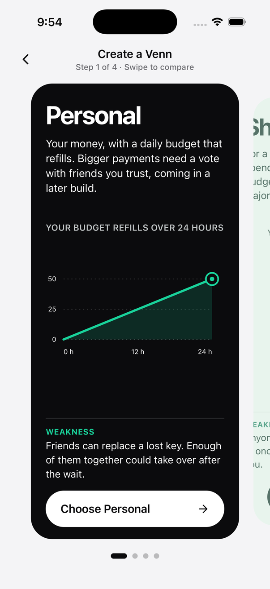

# Venn

Built by **salemkode** as a solo BCH BLAZE 2026 entry. [BUIDL](https://dorahacks.io/buidl/51333) · [Pitch deck](https://docs.google.com/presentation/d/1NcDfEq6mmGHIi0OvOzE1qG8dILfKJSs_7BqTaGnA9KI/edit?usp=sharing) · [Live demo](https://venn.salemkode.com/) · EMBER2026 voting address: `bitcoincash:zzxajy7s8h5qk0tajmr2rmus40ypcs9csvu8j9wgrd`

**A Bitcoin Cash wallet for people who share a fund and want to agree on who can spend it.** A housemate can pay for groceries from their own allowance. A larger purchase needs a group vote. Before joining, each person sees both their spending rights and the power they give the other members. The shared fund is called a *Venn*.

Venn starts on **Bitcoin Cash Mainnet**, where shared funds hold **MUSD** (Moria USD). **Chipnet** stays one choice away in Settings → Network, with **Venn Test USD**, a two-decimal test CashToken. [Test asset and funding instructions](docs/blaze/stablecoin.md) The native app implements invitations, signed seat acceptance, fund creation, budget payments, group votes (proposals and approvals shared as codes), lost-phone recovery, and savings Circles. [How the contracts work](docs/contracts.md)

[Watch the 68-second walkthrough](docs/blaze/walkthrough.mp4) · [Read the transcript](docs/blaze/transcript.txt) · [Download the pitch deck](docs/blaze/venn-blaze-2026.pptx) · [BLAZE entry brief](docs/blaze/SUBMISSION.md)

## Try the grocery payment

Imagine Sara has **50.00 Venn Test USD** available in a household fund. What stops Sara from spending more than her allowance?

| Payment from the same starting balance | What the Bitcoin Cash virtual machine checks |
| --- | --- |
| Sara pays the shop **20.00 Venn Test USD** | The signed transaction pays the shop and updates Sara’s allowance to **30.00 Venn Test USD**. The VM accepts it. |
| Sara tries **50.01 Venn Test USD** | The transaction exceeds her allowance by one cent. The VM rejects it, so her allowance stays at **50.00 Venn Test USD**. |

Run the stablecoin test from the repository root with Node.js 22.13 or newer. It builds signed Venn creation and payment transactions, checks them in the BCH VM, and checks that seat consent binds the CashToken category.

```sh
npm ci
npm test -- tests/venn/stablecoin.test.ts
```

The [XO allowance demo](contracts/xo-allowance/README.md) (template v3) includes the live test-dollar mint, payment, follow-up payment, sponsor refund, the network refusing payments made before their interval, and debugger-readable invitations. The [website](docs/blaze/landing.html) explains Venn to everyday users with a dollar-budget example. The walkthrough video shows the earlier BCH-denominated prototype; the [demo guide](docs/blaze/DEMO.md) has the current judge path.

## From a plan to a shared payment

1. **Choose the rules.** The creator names the members, sets their budgets, and chooses who can approve payments, change the rules or help recover a seat.
2. **Accept a seat.** Each invited person reads the terms and signs for their seat with their own Venn key. Changing the plan invalidates the acceptance.
3. **Fund the Venn.** Once everyone has accepted, the creator deposits the Venn's dollars (MUSD on Mainnet, Venn Test USD on Chipnet). The creation transaction also sends invited keys a small amount of BCH for network fees and includes a marker so their wallets can find the fund.
4. **Pay the shop.** Sara reviews the address, amount, fee, total and network. Her member card records her spending allowance. The covenant requires a valid signature, enough budget and a correctly updated card. Sara pays the network fee from her separate Venn key.



Every kind can be created in the app. A Pot pays out by group vote; a Circle runs on its own contract that fixes the turn order and the contribution.

| Starting preset | Who can spend? | What members need to know |
| --- | --- | --- |
| **Personal** | The owner has a refilling budget and must sign every vote. | Enough helpers can replace the owner’s key after a waiting period. |
| **Shared** | Members have individual budgets. Larger payments need a majority. | A member can spend their full allowance at once. A majority can act against the others. |
| **Pot** | Every payment requires a vote. | The fund can sit idle while members are unavailable. |
| **Circle** | A savings group (jam’eya): everyone pays the same each round and the contract pays the pot to whoever’s turn it is. | The contract cannot make anyone pay; a member who stops after their own turn keeps what they received. |

## Run the app

| Platform | How to start | What to try |
| --- | --- | --- |
| **iOS or Android** | After `npm ci`, run `npm run setup:native`, then `npm run ios` or `npm run android` with Xcode or Android Studio installed. | Open **Venns → Create a Venn → Shared**. To try it for free, switch to Chipnet in **Settings → Network** and use two local test wallets. |
| **Android preview** | Install the [signed BLAZE preview and checksum](https://github.com/salemkode/venn-blaze-2026/releases/tag/blaze-2026-android-preview) (built 19 November, Chipnet only). It has its own application ID and a standalone release bundle. | Try planning, seat acceptance and shared spending on Chipnet. |
| **Web wallet** | Open https://venn.salemkode.com/ or run `npm run web` and open [localhost:8099](http://localhost:8099). On a desktop the app is shown inside a phone frame. | Select **Connect a wallet** and pair a WizardConnect wallet (Cashonize, for example). Venn opens on Mainnet; the wallet keeps its keys and approves each BCH payment. |
| **Hackathon website** | Run `npm run build:blaze`. Serve `dist/` at the site root and open `/blaze/`. | Judges can try the example, watch the walkthrough, get the deck and open the actual web wallet. Serve existing files first and fall back to `/index.html` for wallet routes. |

Native builds use Expo 58, React Native 0.88 and Metro on port **8097**. Use `npm start` for an installed development client. Expo Go lacks Venn’s local crypto and secure storage modules. For a landing-only export, `npm run build:landing` writes to `dist-landing/`. [Device setup](docs/development.md) · [Two-wallet rehearsal and hosted checks](docs/blaze/DEMO.md)

## What enforces the rules?

A **CashScript covenant** controls how the shared BCH can move. CashTokens store the group state on-chain. One rules NFT holds the approval policy and member counts. Each member has a mutable NFT recording their key, roles, budget and recovery state. Spending updates that card within the payment transaction. The app checks the contract template, creation transaction and current rules/card counts before showing **Official Venn contract, Venn v2** (fingerprint `6d22393b`); Circles use their own contract (Circle v1, `6d083bf6`). The app collects every member's signed acceptance before it builds a Venn; checking every on-chain term against the plan each member accepted is still open. [Contract source](contracts/VennVault.cash) · [Official registry](contracts/registry.json) · [Verification code](src/venn/verify.ts)

Native recovery phrases use Keychain or Keystore. Local wallets derive a dedicated Venn key at `m/44'/<coin>'/0'/7/0`. Ordinary payments use XO. Venn transactions save their transaction ID before broadcast and block another shared-fund submission until that transaction is resolved. If a submission times out, check chain state before taking further action. The contracts have had two AI-assisted internal reviews and await an independent audit. Keep Mainnet amounts small. [Wallet code](src/wallet/) · [Venn transaction builders](src/venn/) · [Native crypto adapter](modules/libauth-native/)

## Verification and release status

```sh
npm test
npm run typecheck
npm run lint
npm run test:native-core
npx expo-doctor
```

The local checks cover contract behavior, wallet payment boundaries, navigation and native crypto comparisons. On 20 November the production web build paired a fresh Cashonize wallet over WizardConnect on Mainnet and completed a payment on Chipnet ([details](docs/blaze/DEMO.md#verified-on-20-november)). Judges can read the [public BLAZE source snapshot](https://github.com/salemkode/venn-blaze-2026). The submission brief tracks those items and the organizer requirements. [Demo evidence](docs/blaze/DEMO.md) · [Latest UI review](docs/qa/redesign-2026-11-18.md) · [Submission checklist](docs/blaze/SUBMISSION.md) · [MIT license](LICENSE)

## On-chain receipts

On Mainnet (19 November), a script built on the app's own transaction builders ran Venn v2 and a Circle with real MUSD and two test keys: [Venn creation](https://explorer.bitcoinunlimited.info/tx/40bdcea8d2a8dd44564f204afa433f77733047fbb479a02d4eb02a8f5e184b33), [budget payment](https://explorer.bitcoinunlimited.info/tx/c9bfc422bcff62299d17f46d45b1476d19aae0fb42e5266298b1f9a709c8a6f4), [group-vote payment](https://explorer.bitcoinunlimited.info/tx/adb33e9aaa54a80c32a8d0ca989cdacc72b085c3dd1ca97231d0a972b720e482) and [a Circle](https://explorer.bitcoinunlimited.info/tx/c593a2d3e57f1e06b43833cb0274b7ec38dc6a3d5c0d742648780af7771344d6). All MUSD went back to its owner. [Mainnet run](docs/live-mainnet-2026-11-19.md)

On Chipnet, two wallets in the Android app created a [Shared Venn](https://chipnet.imaginary.cash/tx/f464fc58723e4c1863a7640db6f03a4e096f6d9915d53ddd5c1fc3de0c1502e3), passed a [two-signer payment](https://chipnet.imaginary.cash/tx/327937016f413d699646c5666f07e9cbcde1a63f7d9b641d25c83345a1aa4acb), paid out a [Circle round](https://chipnet.imaginary.cash/tx/10fa0a5e2ea7e521b701a9dc53b2821adce68bdabf9c7830960f79c02650b291), and requested and stopped a recovery; a script completed a [seat recovery](https://chipnet.imaginary.cash/tx/d2b69db5554422a105572969df3284a06b051e704ccb8b1c4ea759b5133fa851). [Chipnet run](docs/live-chipnet-2026-11-19.md) · [All receipts](docs/blaze/SUBMISSION.md#evidence)
