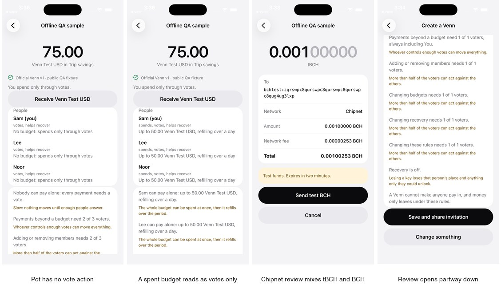

# Venn iOS route review · 18 November 2026

**Release decision.** Keep the current build in Chipnet testing. The main Receive button gives the user a BCH address, and the token flow accepts Venn Test USD on Chipnet. A user arriving to receive MUSD cannot complete that task. The app also lets people choose shared-money plans whose main payout action they cannot perform in this build.

The review covered all 19 app-owned routes on the assigned iOS simulator, using the Expo 58 development build, Expo Router’s live sitemap and Argent. The count excludes the two navigator layouts and Expo-generated utility screens. For balances, approvals and receipts that the unfunded wallet could not produce, the real screen components ran on the simulator with temporary, in-memory sample data. The sample harness was removed after the review. [Expo Router sitemap](https://docs.expo.dev/router/reference/sitemap/)

## Findings

| Priority | Finding and evidence | What a user should be able to do |
| --- | --- | --- |
| Blocks MUSD trial | **Receive opens on the wrong asset for the stated product.** Decoding the address actually shown on Wallet → Receive returned ordinary P2PKH. The separate Venn key screen returned token-aware P2PKH on Chipnet and explicitly requested Venn Test USD. Send starts in tBCH, and onboarding still describes a Bitcoin Cash contract. | Open Receive from home, see MUSD and its network above the QR, and share the intended token-aware address. Keep any fee funding explicitly labeled as BCH. |
| Blocks Pot and Circle payouts | **The app advertises voting and recovery ahead of the available controls.** Pot and Circle explain majority approval. A populated Pot showed a balance, members and Receive. Its detail screen says that signing votes and recovery requests is coming later. The same limitation affects above-budget payments for other styles. | Know which actions are available before joining or depositing. Enable funded voting presets when members can propose, approve and complete their payout. |
| High | **A supported group can exceed the invitation QR limit.** A 20-seat Shared plan with short first names passed plan and invitation validation. Its 2,832-character invitation failed in the same QR encoder and error-correction mode used by the app. The invitation screen renders the QR ahead of Share and supplies no error fallback. This was verified at the encoder, not by saving a large plan in the test wallet. | Open a valid plan and share its invitation as text even when a QR cannot be drawn. |
| High | **Back discards setup work.** Entering “QA trip draft”, continuing to Rules and pressing the native Back button returned to the preset picker. Reopening Personal restored the default placeholder. Rules also has no action to edit the people already entered. | Return one step to edit people or the name while preserving the draft. |
| Medium | **Chipnet payment review mixes currencies on the confirmation screen.** The sample showed tBCH above the address but BCH beside the amount, fee and total. The confirmation button said “Send test BCH”. | Read one consistent unit beside every amount before confirming. |
| Medium | **An empty budget is described as a permanent spending restriction.** A Shared seat with a daily allowance of 50 and zero currently available displayed “You spend only through votes.” Its own member card still showed the refilling allowance. | Distinguish a temporarily spent allowance from a member who has no solo spending permission. |
| Medium | **The review opens below the start of the summary.** After scrolling to Review at the bottom of Rules, the next step retained the scroll position. The plan name and opening terms were above the viewport while Save was visible. | Start each new step at its heading and review the terms in reading order. |
| Medium | **Important fields have no accessible name.** In the iOS accessibility tree, the Venn payment address and amount were unnamed text fields. The Join invitation field had a test identifier but no label. The visible captions are separate text nodes. | Hear the purpose of each field when moving through inputs with a screen reader. |
| Medium | **Removing an invitation plan has no confirmation or undo in the handler.** Code inspection traced the Delete button directly to removal of the local plan. The audit did not delete a saved plan. | Recover from an accidental tap, especially after collecting acceptances. |
| Design | **The empty Venns tab leads with “BCH for fees, 0 sat”.** The remaining screen is mostly blank, with Create and Join offering no clue which one a first-time user needs. A fully accepted sample plan still said “Waiting for 0 of 2 to accept”. | See one relevant next step for each state, such as creating a first group, opening an invitation or reviewing a first deposit. |

**Where to make changes.** The primary receive route and key route choose different address sources. The asset policy sets the Chipnet category. The invitation schema and QR renderer determine the group-size behavior. Setup steps share one outer scroll view. [Receive route](<../../src/app/(wallet)/receive.tsx>) · [Venn key route](<../../src/app/(wallet)/key.tsx>) · [Asset policy](../../src/venn/asset.ts) · [Invitation schema](../../src/venn/invite.ts) · [Venn screens](../../src/screens/Venns.tsx) · [Create wizard](../../src/screens/CreateVenn.tsx) · [Send review](../../src/screens/Send.tsx) · [Shared field](../../src/ui/kit.tsx)

## Route coverage

| App route | What was checked |
| --- | --- |
| Root index | A ready wallet redirected to Wallet. The first-wallet welcome and empty restore form were rendered with sample state. |
| Intro | All six introduction scenes, including the final Done action being visible. The contract and recovery claims remain visible. |
| Wallet tab | Chipnet home, balance, wallet selector, Receive, Send and Refresh. The experience leads with BCH. |
| Venns tab | Empty list, fee row, Create and Join. A populated sample exposed the “Waiting for 0” issue. |
| Settings tab | Wallet management, recovery, network, introduction and version. |
| Wallets | Active wallet and add, import and connect choices. Opened the empty import form. |
| Connect | The WizardConnect pairing screen displayed a QR, device-opening action and sharing action. Pairing with a second wallet remains unverified. |
| Network | Chipnet selection, Mainnet confirmation and cancellation back to Chipnet. |
| Recovery | The local-wallet screen opened concealed with a deliberate reveal action. |
| Receive | Address type decoded from the displayed value. Share and the Chipnet faucet action were visible. |
| Send | Empty and prefilled recipient states, keypad and review action. The review and submitted receipt used sample data. |
| Transaction | Missing-transaction message in the route and a populated confirmed detail with date, amount and ID in sample state. |
| Create | All four preset pages, the people form, rules, summary, and the Back and scroll behavior above. |
| Join | Empty input, invalid-code feedback and a valid public three-seat invitation parsed through the real route into seat selection and rules review. |
| Plan | Missing-plan handling in the route. Sample plans covered outstanding and collected acceptances, the deposit form and first-deposit review. |
| Venn detail | Missing-record handling in the route. Populated samples covered a Shared allowance, a spent allowance, a vote-only Pot, payment entry and token payment review. |
| Fee balance | Half-height sheet from the Venns tab, balance and refresh action. Top up opened the fee address. |
| Venn key | Token-aware receiving address, separate BCH funding address, and funding navigation into Send with the recipient prefilled. |
| Development | Native SHA-256, Schnorr and Keychain checks all reported Passed. |

**Verification and limits.** The 108 automated tests, TypeScript and Expo lint passed after removing the sample harness. The review used the iOS simulator in portrait. Android, web, full VoiceOver navigation, external wallet pairing, phrase reveal or restore, and live signing or broadcasting were outside this pass. Existing payment and privacy tests provide separate automated evidence for some of those paths. No real funds were used.
