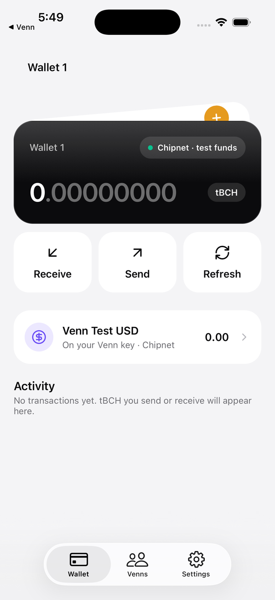
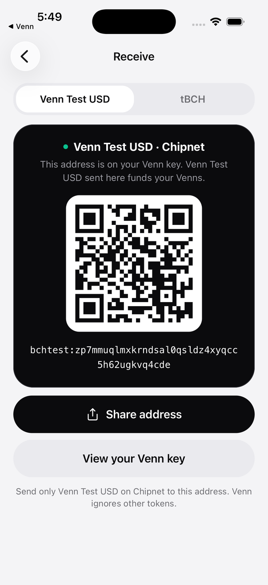
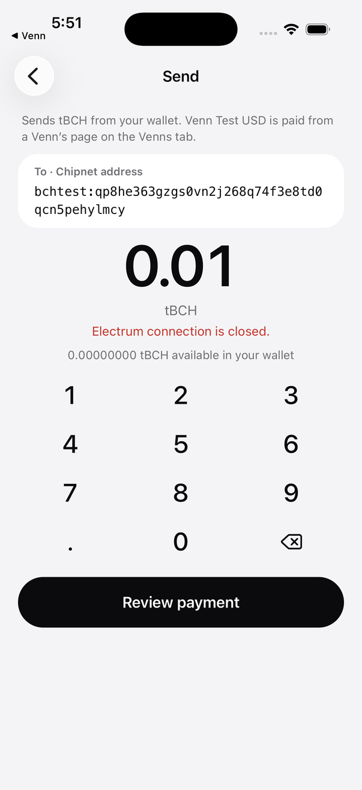
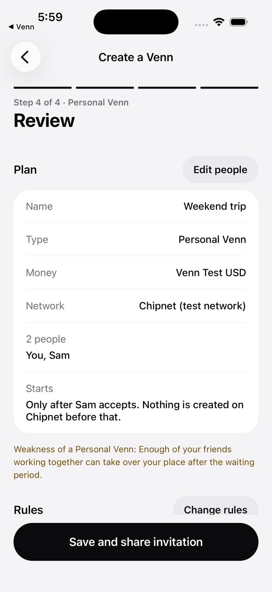
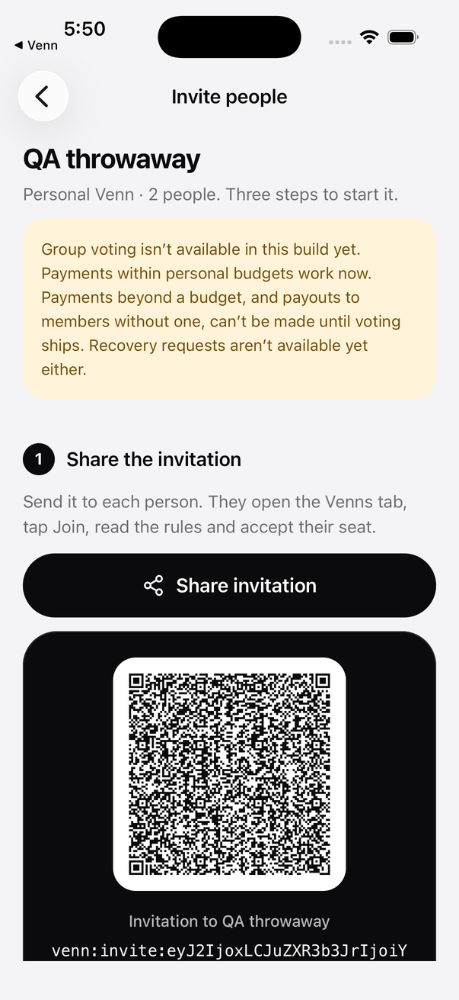
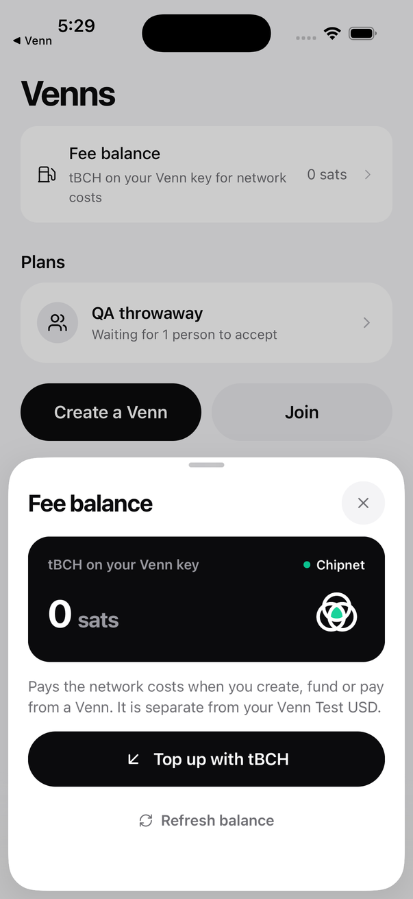
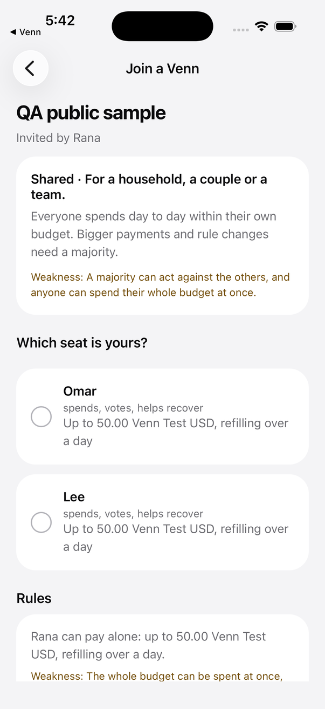
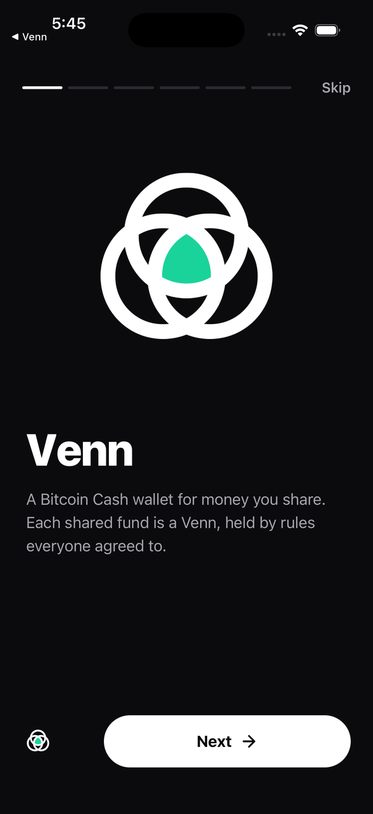
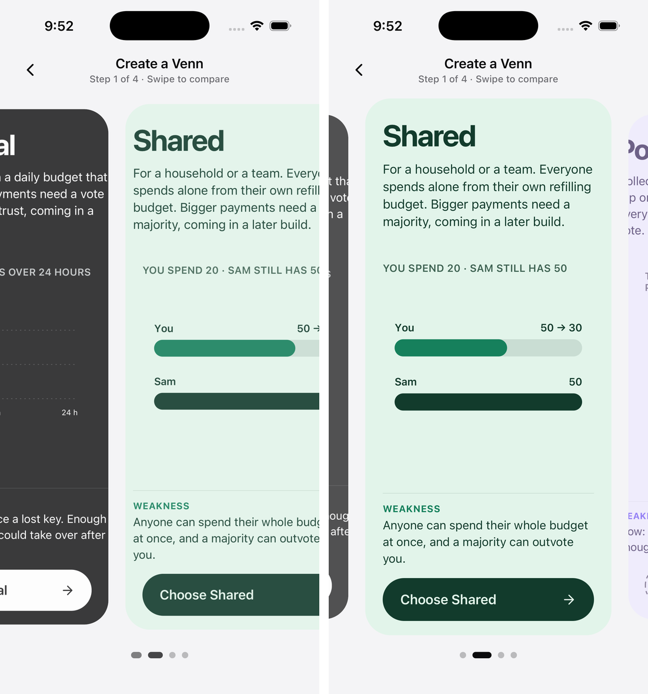

# Venn redesign follow-up · 18 November 2026

This pass redesigned every app route and resolved the findings in the [iOS route review](ios-route-review-2026-11-18.md). All 19 routes were rechecked on the iOS simulator through Expo Router’s sitemap and Argent, against a current development build on Metro 8097.

## Findings and resolution

| Earlier finding | Resolution | Evidence |
| --- | --- | --- |
| Receive gave a plain BCH address | Receive opens on **Venn Test USD** with the token-aware Venn key address, shows asset and network above the QR, and switches to tBCH. Supports `?asset=usd` and `?asset=bch`. | Device |
| Pot and Circle promise vote payouts the app can’t perform | Pot and Circle are shown as **coming soon** and can’t be created. Join, Venn detail and onboarding say plainly that group voting and recovery aren’t in this build. | Device |
| 20-seat invitation exceeded the QR limit | `SafeQR` uses low error correction and falls back to a message; **Share** sits above the QR and always works. | Code |
| Back discarded the setup draft | Native Back and swipe-back step back inside the wizard. Drafts are kept per preset for the session and restored on reopen. Rules and Review offer **Edit people**. | Device |
| Chipnet review mixed tBCH and BCH | Compose, review, receipt and confirm button use one unit (tBCH on Chipnet, BCH on Mainnet). Venn fees read as “N sats” of tBCH everywhere. | Device (compose), code (review) |
| Spent allowance read as “votes only” | The Venn page separates “allowance used, refills over time” from “no solo spending in this Venn”. | Code |
| Review opened partway down | Each wizard step opens at its heading. | Device |
| Fields had no accessible name | The shared `Field` sets the accessible label and hint and shows errors inline; the Send address and amount have spoken names. | Device |
| Delete plan had no confirmation | Delete asks first and states how many acceptances will be lost. | Device |
| Empty Venns tab led with the fee row | The empty state leads with **Create your first Venn** and **Join with an invitation**; the fee row appears once a Venn or plan exists. Plans read “Everyone accepted · ready to fund” or “Waiting for N to accept”. | Device |

## Further fixes found during the device pass

- The keyboard covered the wizard’s footer because the keyboard avoider ignored the native header height (`src/ui/Page.tsx`).
- After an idle socket drop, Refresh now opens a fresh Electrum session. Only Refresh reconnects; payments are never retried (`src/wallet/useWallet.ts`).
- Invalid invitation codes show a plain message instead of a JSON parse error.
- Missing plan and Venn records show loading text and a way back.
- Onboarding, Welcome, Settings, Wallets, Connect, Network and Recovery copy now matches what this build does.

## Screenshots

| | |
| --- | --- |
|  |  |
|  |  |
|  |  |
|  |  |

Create a Venn opens on four big swipeable cards. The next card peeks in from the edge, and each card’s example graph draws in with the swipe as it reaches the centre.

Screenshot 03 was captured while the server connection was down, before the reworded message landed.

## Verification and limits

`npm test` (108 tests), `npm run typecheck`, `npm run lint` and `npx expo-doctor` (20/20) pass. Populated Venn detail, Send review and receipt, the QR fallback and the fully accepted plan were checked in code only, because the test wallet holds no funds and no second wallet accepted. Android, web, external wallet pairing and live broadcasts were not part of this pass. The installed `com.salemkode.venn` simulator build predates React Native 0.88 and needs `npx expo run:ios` before reuse. Group voting and recovery screens remain the main functional gap.
